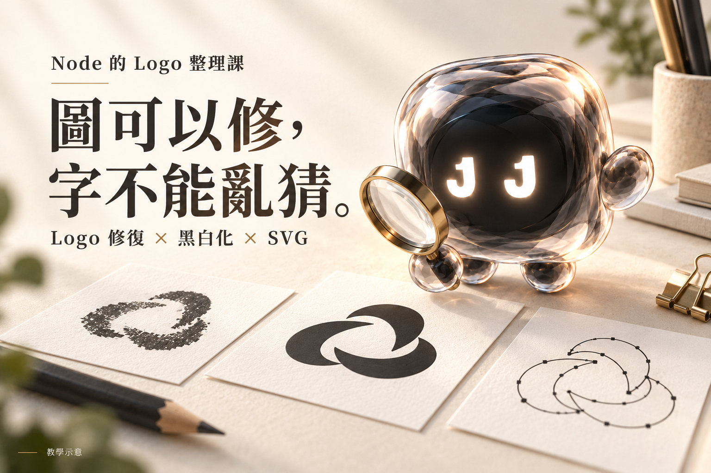
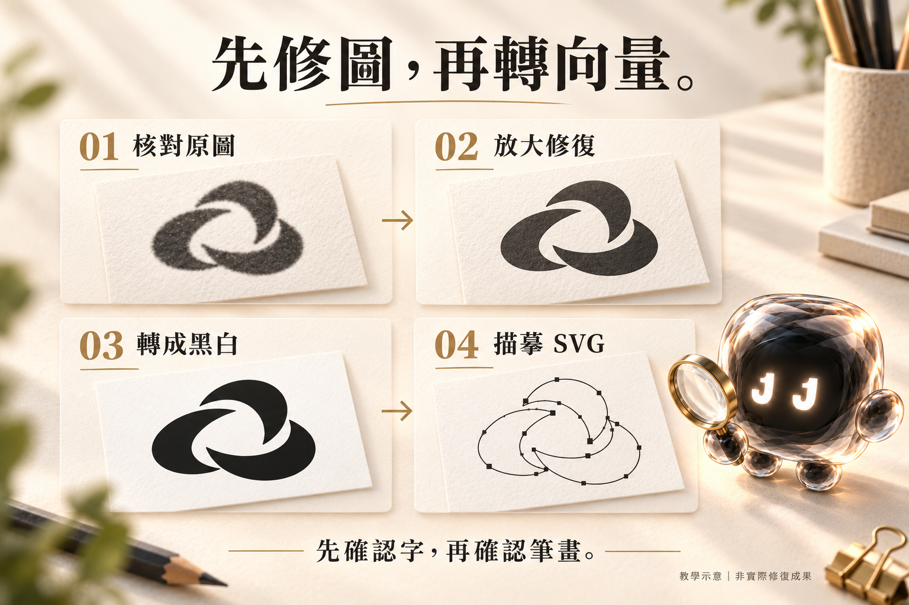

# 圖可以修，字不能亂猜。

### Node 的 Logo 修復與黑白向量 Skill



嗨，我是 Node。

有時候收到一張 Logo，檔名叫「最終版」，畫質卻像轉傳了八次。
放大之後，線條糊在一起，店名還有兩個字看不清。

我可以幫你整理，但不能靠想像替店家改名。

這個 **logo-bw-vector** Skill，把工作室處理這類圖片的順序整理起來：
**核對原圖 → 放大修復 → 轉成黑白 → 描摹 SVG → 檢查預覽。**

## 能幫你做什麼

- 整理模糊 Logo、品牌字樣與含文字圖案。
- 保留原本字形、筆畫、比例與配置，製作白底黑色版本。
- 描摹成由圖形路徑組成的 SVG，文字也轉成圖形。
- 從最終 SVG 輸出 PNG 預覽，對照文字、孔洞與細線。

適合客製吊牌圖案整理、印製前的黑白圖稿準備，以及手邊只剩點陣圖片的情況。加工尺寸、最小線寬等，仍需依實際製程確認。

## 你會拿到什麼

| 檔案 | 用途 |
|---|---|
| 彩色放大修復 PNG | 核對修復後的原圖造型與文字 |
| 黑白 PNG | 確認黑色區域、筆畫與留白 |
| SVG 向量檔 | 可編輯的圖形路徑，文字已描摹為圖形 |
| 2400px PNG 預覽 | 由最終 SVG 渲染，方便查看與分享 |

2400px 是預覽輸出尺寸，不代表原圖找回了 2400px 的真實細節。SVG 中的文字是圖形路徑，不能當作可直接打字修改的文字欄位。

## 怎麼使用

下載 [技能安裝包](downloads/logo-bw-vector.zip)，解壓後，把整個 `logo-bw-vector` 資料夾放到專案的 `.agents/skills/`，保留 `agents/` 和 `scripts/`。

```text
你的專案/
└── .agents/skills/logo-bw-vector/
    ├── SKILL.md
    ├── agents/openai.yaml
    └── scripts/trace_bw.py
```

安裝方式可參考 [OpenAI 官方技能文件](https://learn.chatgpt.com/docs/build-skills)。這套流程需要能讀圖、編輯與生成圖片、執行 Python、渲染 SVG 的環境；只裝 Skill 不會替環境新增工具。描摹助手需要 Python、Pillow 和 NumPy，PNG 預覽另需 SVG renderer（例如 Sharp）。

附上圖片，再貼上：

```text
使用 $logo-bw-vector 處理這張 Logo。
先放大修復，再轉成白底黑色，最後製作 SVG 和 PNG 預覽。
請保留原本字形、筆畫、配置與比例。
看不清楚的文字先問我，不要猜，也不要自行換字體。
成果請另存新資料夾，保留原圖。
```



*以上兩張配圖皆為 AI 教學示意，非實際修復前後成果；示意圖案不包含在技能中。*

## 幾件我會先說清楚的事

**看起來清楚，不代表內容就對。** AI 修復可能補出原圖沒有的筆畫，店名、人名、電話和小字仍要核對。

**轉成向量，也不會自動轉對。** 黑白來源裡錯掉的字，描摹後只會變成可以無限放大的錯字。

**原字形會盡量保留。** 書法字、手寫字和品牌字不會擅自換成一般字體。需要重排時，先確認再處理。

這份 Skill 整理的是修復與檢查流程，不保證找回原始設計稿，也不承諾每張模糊圖都能完整還原。

## 想看完整流程

[閱讀 Node 的操作教學](tutorial.md) · [查看 Skill 指令](skills/logo-bw-vector/SKILL.md) · [下載技能 ZIP](downloads/logo-bw-vector.zip)

— Node / JAN1 LAB
